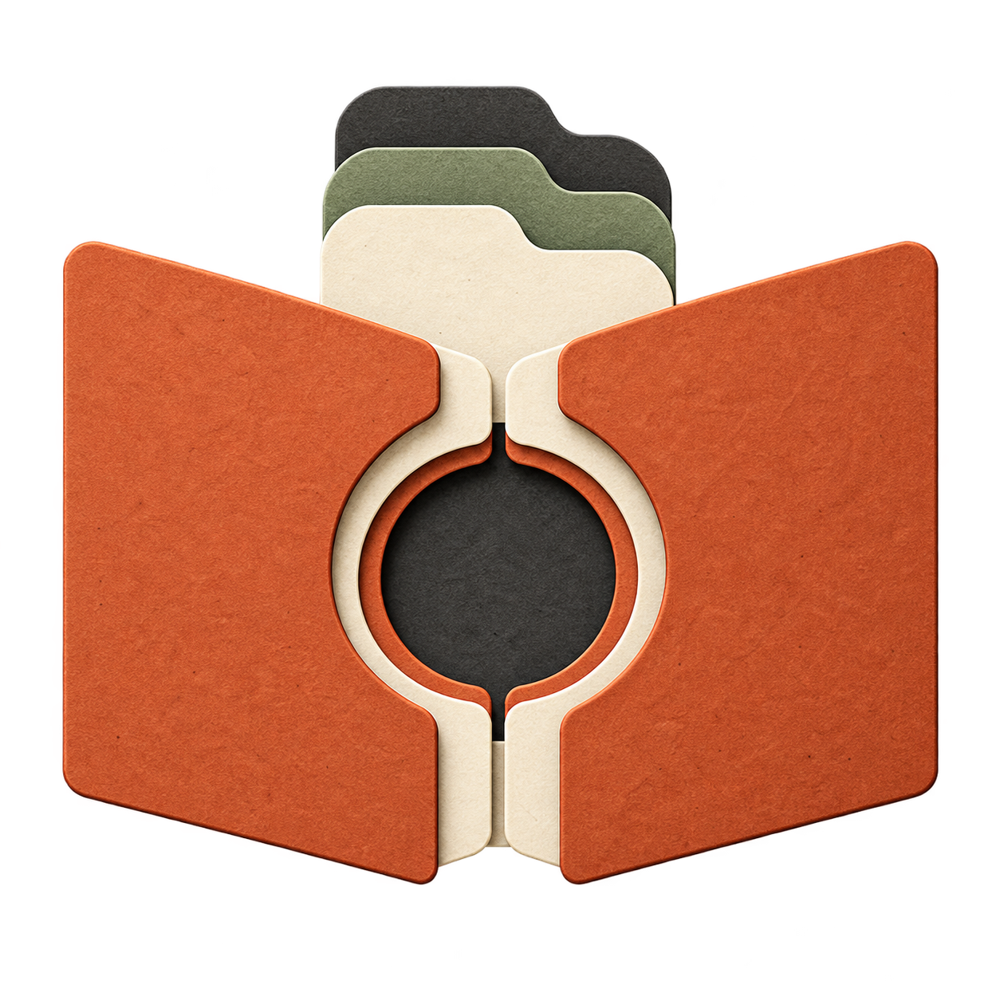

# Claude Mods

Focused tools for deliberate context, useful interfaces, and less wasted work in Claude Code.



[](https://github.com/GadDev/claude-mods/actions/workflows/ci.yml)
[](LICENSE)

An independent collection by [GadDev](https://github.com/GadDev). Each mod is an independently installable plugin. No affiliation with Anthropic.

## Available mods

| Mod | Purpose | Status |
| --- | --- | --- |
| [Context Studio](mods/context-studio/README.md) | Select source excerpts, inspect a task packet, and append it to your prompt draft | Experimental prototype, 0.1.0 |

Output Lens, Retry Map, Instruction Workbench, Task Capsules, Agent Budget Board, and Symbol Navigator are [roadmap ideas](docs/roadmap.md). They are not installable yet.

## Try Context Studio

You need Claude Code CLI **2.1.287 or later**. Desktop and VS Code support depend on their bundled engine and available UI elements; see [compatibility](docs/compatibility.md). Node.js is only needed to develop this repository.

In Claude Code:

```text
/plugin marketplace add GadDev/claude-mods
/plugin install context-studio@gaddev-mods
```

Restart the session or run `/reload-plugins`, then open `/context-studio`.

1. Set a concrete task.
2. Add a source range such as `src/app.ts:1-30`.
3. Choose **Verify and preview**.
4. Choose **Append verified packet to draft**, inspect it, and press Enter yourself.

The mod makes no background model calls, changes no source files, and does not submit prompts automatically. Once you send a packet, it becomes ordinary model context. It does not remove previous context or guarantee savings.

## Develop

Use Node.js 24+ and npm:

```sh
npm ci
npm run types:fetch
npm run check
claude --plugin-dir ./mods/context-studio
```

The type-fetch step verifies a pinned copy of Anthropic's official declarations. Runtime code has no third-party dependencies and no build step. [Development and testing](docs/development.md) covers the local Claude validation commands and their limits.

## Documentation

- [Context Studio usage and commands](mods/context-studio/README.md)
- [Architecture and repository structure](docs/architecture.md)
- [Development and testing](docs/development.md)
- [Compatibility and troubleshooting](docs/compatibility.md)
- [Release operations and PR labels](docs/releases.md)
- [Measurement methodology](docs/measurement.md)
- [Roadmap](docs/roadmap.md)
- [Custom mod icons](docs/icons.md)
- [Contributing](CONTRIBUTING.md), [security](SECURITY.md), and [community conduct](CODE_OF_CONDUCT.md)

## License

[MIT](LICENSE). Source code and original project assets use this license unless a file says otherwise. Third-party names remain their owners' property.
