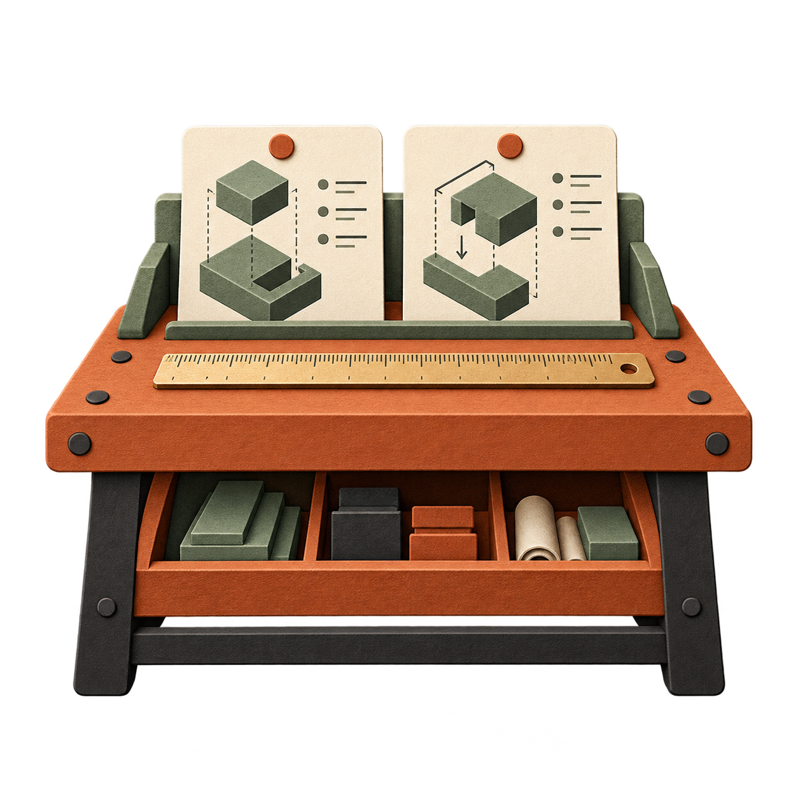

# Claude Mods

Focused tools for deliberate context, useful interfaces, and less wasted work in Claude Code.

[](https://github.com/GadDev/claude-mods/actions/workflows/ci.yml)
[](LICENSE)

An independent collection by [GadDev](https://github.com/GadDev). Each mod is an independently installable plugin. No affiliation with Anthropic.

## Available mods

Each available mod has its own icon, documentation, and installation. Context Studio is at version 1.0.0; Output Lens and Retry Map are experimental prototypes at version 0.1.0.

| Icon                                                                                                                            | Mod                                             | What it helps you do                                                                                               |
| ------------------------------------------------------------------------------------------------------------------------------- | ----------------------------------------------- | ------------------------------------------------------------------------------------------------------------------ |
|  | [Context Studio](mods/context-studio/README.md) | Select source excerpts, verify their freshness, and append a reviewed task packet to your prompt draft.            |
|        | [Output Lens](mods/output-lens/README.md)       | Inspect a selected Vitest JSON report and retrieve bounded summaries, individual diagnostics, or raw report pages. |
|                    | [Retry Map](mods/retry-map/README.md)           | Recognize identical Bash failures and inspect retry history without blocking commands or changing tool results.    |

## Planned mods

These concepts have custom artwork and a [roadmap](docs/roadmap.md), but are not installable yet.

| Icon                                                                                                                                        | Mod                   | Planned purpose                                                                            |
| ------------------------------------------------------------------------------------------------------------------------------------------- | --------------------- | ------------------------------------------------------------------------------------------ |
|  | Instruction Workbench | Review duplicated instructions and their scope, with source references and proposed edits. |
|                      | Task Capsules         | Prepare a reviewed handoff with decisions and source freshness for a separate task.        |
|          | Agent Budget Board    | Preview worker scope and resource choices before starting agents.                          |
|                         | Symbol Navigator      | Select definitions and references with provenance and bounded retrieval.                   |

See the [icon gallery](docs/icons.md) for the original artwork and asset details.

## Try Output Lens and Retry Map

Each installs independently:

```text
/plugin marketplace add GadDev/claude-mods
/plugin install output-lens@gaddev-mods
/plugin install retry-map@gaddev-mods
```

After reloading plugins, generate a Vitest JSON report through your usual test command and select it with `/output-lens load vitest-results.json`. Open `/output-lens` to inspect it, or ask Claude to use its report tool for concise diagnostics. Open `/retry-map` to inspect repeated Bash tool failures; it observes without blocking commands or changing their output.

These target reduced diagnostic context and earlier intervention in repeated failures. Savings remain unbenchmarked. Current Vitest already offers an agent-friendly reporter; Output Lens adds structured report inspection and evidence retrieval.

## Try Context Studio

You need Claude Code CLI **2.1.287 or later**. Desktop and VS Code support depend on their bundled engine and available UI elements; see [compatibility](docs/compatibility.md). Node.js is only needed to develop this repository.

In Claude Code:

```text
/plugin marketplace add GadDev/claude-mods
/plugin install context-studio@gaddev-mods
```

Restart the session or run `/reload-plugins`, then open `/context-studio`.

1. Set a concrete task.
2. Add a source range such as `src/app.ts:1-30`.
3. Choose **Verify and preview**.
4. Choose **Append verified packet to draft**, inspect it, and press Enter yourself.

The mod makes no background model calls, changes no source files, and does not submit prompts automatically. Once you send a packet, it becomes ordinary model context. It does not remove previous context or guarantee savings.

## Develop

Use Node.js 24+ and npm:

```sh
npm ci
npm run types:fetch
npm run check
claude --plugin-dir ./mods/context-studio
```

`npm ci` installs the Husky pre-commit hook. It uses lint-staged to lint staged code with Oxlint and format supported staged files with Oxfmt, preserving unstaged edits.

```sh
npm run lint          # Check code with Oxlint
npm run format        # Apply Oxfmt formatting
npm run format:check  # Check formatting without writing
```

`npm run check` runs lint, formatting, repository validation, TypeScript, and Node/native tests. The same command runs in CI. See [contributing](CONTRIBUTING.md) for the full workflow.

The type-fetch step verifies a pinned copy of Anthropic's official declarations. Runtime code has no third-party dependencies and no build step. [Development and testing](docs/development.md) covers the local Claude validation commands and their limits.

## Documentation

- [Context Studio usage and commands](mods/context-studio/README.md)
- [Output Lens usage and commands](mods/output-lens/README.md)
- [Retry Map usage and commands](mods/retry-map/README.md)
- [Architecture and repository structure](docs/architecture.md)
- [Development and testing](docs/development.md)
- [Compatibility and troubleshooting](docs/compatibility.md)
- [Release operations and PR labels](docs/releases.md)
- [Measurement methodology](docs/measurement.md)
- [Roadmap](docs/roadmap.md)
- [Custom mod icons](docs/icons.md)
- [Contributing](CONTRIBUTING.md), [security](SECURITY.md), and [community conduct](CODE_OF_CONDUCT.md)

## License

[MIT](LICENSE). Source code and original project assets use this license unless a file says otherwise. Third-party names remain their owners' property.
