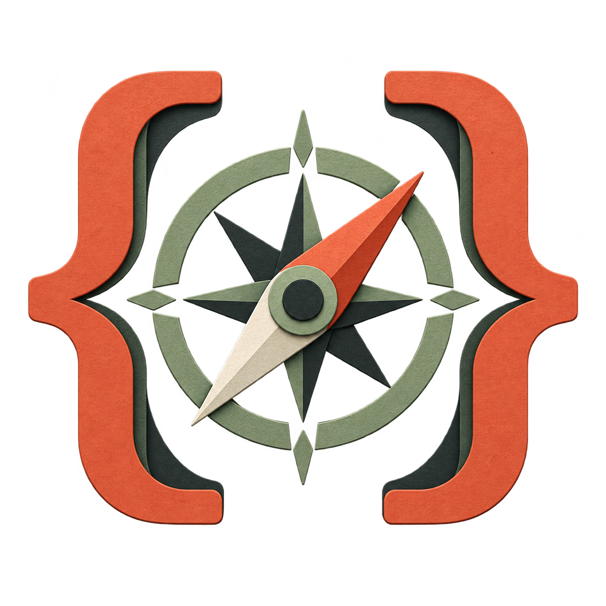

# Custom mod icons

Seven original transparent PNG illustrations share a cut-paper identity: warm terracotta, muted sage, charcoal, tactile grain, and a distinct silhouette for each tool. They were generated individually with the built-in image generation tool on 22 October 2026. They are illustrations for documentation and listing artwork; use simple native text labels for small terminal controls.

Context Studio, Output Lens, Retry Map, Instruction Workbench, and Task Capsules are implemented. The other two icons represent roadmap concepts.

| Context Studio                                                                                              | Output Lens                                                                                                | Retry Map                                                                                            |
| ----------------------------------------------------------------------------------------------------------- | ---------------------------------------------------------------------------------------------------------- | ---------------------------------------------------------------------------------------------------- |
|  |  |  |

| Instruction Workbench                                                                                                      | Task Capsules                                                                                             | Agent Budget Board                                                                                                |
| -------------------------------------------------------------------------------------------------------------------------- | --------------------------------------------------------------------------------------------------------- | ----------------------------------------------------------------------------------------------------------------- |
|  |  |  |

**Symbol Navigator** — precise code navigation.

## Asset locations

Implemented mods ship their icons inside `mods/<name>/assets/icon.png`, declared in each manifest. The two remaining concept assets and the documentation originals for Output Lens, Retry Map, Instruction Workbench, and Task Capsules are in `docs/assets/icons/`. All are square RGBA PNGs with transparency. Originals are retained without recompression or cropping. The icon set follows the repository's MIT license.

## Prompt set

Every icon used this shared prompt, followed by its subject below:

> Use case: logo-brand. Asset type: standalone custom icon for GadDev's independent Claude Code mods collection. Create one polished, original, memorable icon illustration. Shared family: tactile cut-paper geometry, precise silhouette, warm terracotta, muted sage, deep charcoal, subtle paper grain, very restrained relief, front-facing composition, excellent recognition at small sizes. No letters, no words, no text, no existing logos, no watermark, no humanoids, no glowing AI symbols, no glossy 3D. Center a single large symbol with generous transparent margins; genuinely transparent background, no checkerboard painted into the image. Square composition. Subject:

| Asset                 | Subject appended to shared prompt                                                                                        |
| --------------------- | ------------------------------------------------------------------------------------------------------------------------ |
| Context Studio        | An open folio with three layered paper tabs gathered into a precise central aperture, selective context                  |
| Output Lens           | A magnifying lens over a paper strip, a few precise diagnostic marks coming through the lens while other lines stay soft |
| Retry Map             | A looping folded path with two repeated small milestones and one clear breakout arrow                                    |
| Instruction Workbench | A compact drafting workbench with two aligned instruction cards and a single neat measuring rule                         |
| Task Capsules         | A rounded capsule container holding one folded task card, an elegant compact travel case                                 |
| Agent Budget Board    | Three small task tiles connected to a restrained dial, deliberate allocation                                             |
| Symbol Navigator      | Two typographic curly brace shapes surrounding a precise compass needle, navigating code                                 |
